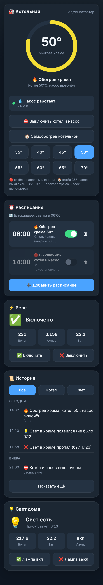
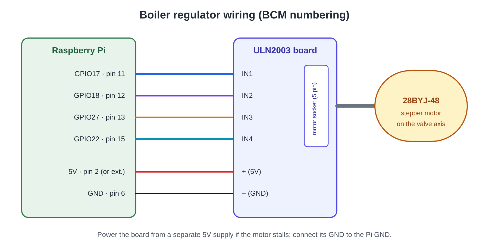
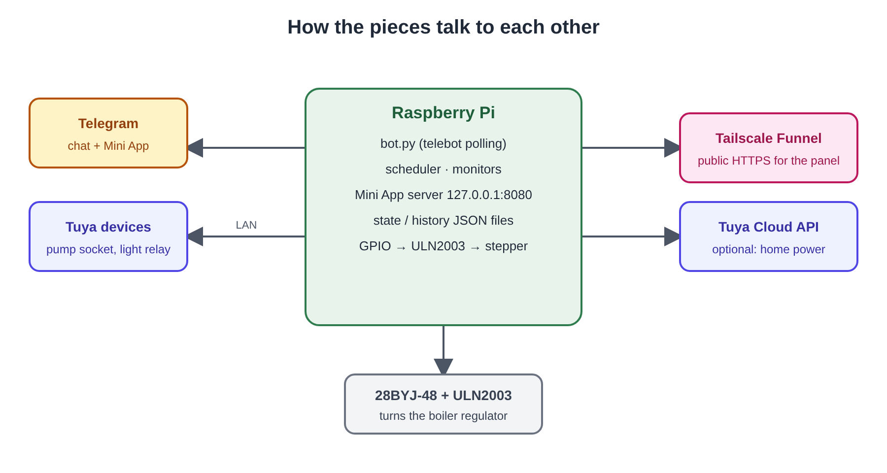

# Pi Boiler Bot

A Telegram bot and Mini App that runs a boiler room from a Raspberry Pi. It turns the regulator knob of a
manual boiler with a stepper motor, switches the circulation pump, watches whether the building has power,
and lets non-technical people do all of it from their phones.



## Why this exists

I built this for the heating of a local church, for free. The boiler there has a plain mechanical regulator,
the boiler room is in the basement, and the people who look after the building are not technical, so
everything had to be obvious and hard to break: big buttons, plain wording, nothing to configure.

The church setup is the only one it has run on so far, so some wording in the interface still refers to it
(see [Status](#status-and-honesty)). Nothing in the logic is specific to a church. Anything with a manual
regulator, a pump on a socket and a power cut now and then will do.

## What it does

- **Boiler control.** Three modes: off, self-heating (lowest temperature, pump off) and heating at a chosen temperature (35–70°, pump on). Each temperature is a number of motor steps from a table in `bot.py`.
- **Live progress.** The Mini App shows the motor moving step by step, and chat messages show a progress bar.
- **Schedules.** "Set 50° at 06:00 on weekdays", "switch everything off at 22:00". Created from a chat wizard or the Mini App form. Runs missed by less than 10 minutes (for example after a reboot) are caught up.
- **History.** Who changed what and when, plus power events, with filters.
- **Power monitoring.** A metered relay and a battery-backed socket tell power loss from network loss: both answer means power is on, only the socket answers means power is off, neither answers means the network is down (logged to history, never sent as a notification, so a flaky link cannot spam anyone). Notifications say how long it lasted.
- **Pump socket and relay.** Local Tuya control over LAN (tinytuya), with voltage, current and power readout.
- **Home power indicator (optional).** A Tuya socket somewhere else, polled through the Tuya cloud, reports into a family group chat with a single `/light` command.
- **Roles.** Access codes give a role: `admin` (everything), `tech` (everything except the home indicator) and an optional notifications-only role that gets the power on/off messages and can ask for the current state. Wrong codes are rate limited.
- **Robustness.** State is written atomically with a `.bak` copy and fsync, restored automatically after a corrupted write, and a motor move interrupted by a power cut is reported on the next start. Missing files are created or reported at startup. Device IP addresses are rediscovered by scanning the LAN when they change.
- **Release notes.** After an update the bot tells every user what is new (`BOT_VERSION` in `bot.py`, `/news`).

## Hardware

| Part | Notes |
| --- | --- |
| Raspberry Pi (any with GPIO) | Tested with Raspberry Pi OS |
| 28BYJ-48 stepper + ULN2003 board | Fixed to the regulator axis |
| Tuya Wi-Fi socket | Circulation pump |
| Tuya DIN-rail relay with metering | Presence of mains power |
| UPS / battery for the socket and router | So the socket stays online when power is lost |



This is the default pin set; change it with `MOTOR_PINS` in `.env`.



## Setup

1. **Install**

   ```bash
   git clone https://github.com/w1cee/pi-boiler-bot.git
   cd pi-boiler-bot
   pip install -r requirements.txt --break-system-packages
   cp .env.example .env
   ```

2. **Create a bot** in [@BotFather](https://t.me/BotFather) and put its token and the access codes of your choice into `.env`.

3. **Tuya devices.** Create a project on [iot.tuya.com](https://iot.tuya.com), link your Smart Life app account, then run:

   ```bash
   python3 -m tinytuya wizard
   ```

   Copy the resulting `devices.json` and `tinytuya.json` next to `bot.py` (see `devices.example.json` and `tinytuya.example.json` for the format). Set `PUMP_SOCKET_NAME` and `LIGHT_RELAY_NAME` in `.env` to the exact device names. IP addresses are updated automatically if they change.

4. **Motor calibration.** Move the regulator to the lowest mark by hand, start the bot, and adjust `TEMP_STEPS` in `bot.py` until each temperature lands where it should. The current position is stored in `motor_state.json`, so do not edit it while the bot runs.

5. **Run as a service**

   ```bash
   sudo cp pi-boiler-bot.service /etc/systemd/system/
   # edit User and paths in the file first
   sudo systemctl enable --now pi-boiler-bot
   journalctl -u pi-boiler-bot -f
   ```

6. **Mini App (optional).** It needs a public HTTPS address. Tailscale Funnel is the easiest:

   ```bash
   sudo tailscale funnel --bg 8080
   ```

   Put the address into `WEBAPP_URL` and restart. The app checks Telegram's signed `initData`, so only users with a role get in.

7. Open the bot, send `/start` and enter a code.

Commands: `/start`, `/news`, `/logout`, `/users`, `/revoke`, `/setgroup` (in the family group), `/light`.

## Adapting it

- **Different regulator.** Change `TEMP_STEPS` and the half-step sequence in the motor section of `bot.py`. If your motor needs backlash compensation there is a `BACKLASH` constant.
- **Different devices.** Anything tinytuya can control locally works the same way as the socket and relay; see `tuya_status` and `tuya_set`.
- **Different roles.** Edit `PERMS` at the top of `bot.py`.
- **No home indicator.** Leave `HOME_LIGHT_DEVICE_ID` empty and the feature stays off.
- **Another language.** All text is inline in `bot.py` and `webapp/index.html` for now.

## Project layout

```
bot.py               bot, schedules, monitors, Mini App server
webapp/index.html    Mini App (single file, no build step)
.env.example         settings and secrets template
pi-boiler-bot.service  systemd unit
docs/                diagrams and screenshot
```

Runtime files (`motor_state.json`, `history.jsonl`, `devices.json`, `tinytuya.json`) are created next to `bot.py` or in `DATA_DIR`, and are ignored by git.

## Status and honesty

- The interface is in Russian, and some texts mention the church it was built for. Feel free to edit the texts or translate them.
- Written with a lot of help from an AI assistant and used on exactly one boiler. Read the code, test the motor with the regulator disconnected first, and do not rely on it as the only safety device of a heating system.
- Not planned: deep support. Pull requests and issues are welcome, replies are not guaranteed.

## License

MIT
